# Regime Classifier - Visual Analysis

This document uses Mermaid diagrams (rendered natively on GitHub) to visualize the accuracy data from [ACCURACY.md](ACCURACY.md).

---

## 1. Predicting "More Volatile Than Usual" (Next 10 Days)

### Accuracy Comparison

```mermaid
bar
    title Accuracy: Predicting High Volatility (Next 10 Days)
    x-axis [Method, Accuracy]
    y-axis "Accuracy %" 0 --> 80
    bar "Classifier (TRANSITION/STRESS/CRISIS)" 60.4
    bar "Classifier (STRESS/CRISIS only)" 63.0
    bar "Baseline: VIX > Median" 74.4
    bar "Baseline: Realized Vol > Median" 67.7
    bar "Coin Flip" 50
```

### Precision, Recall & Days Flagged

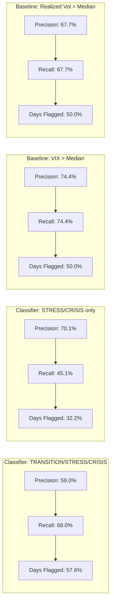

### Key Insight Flowchart

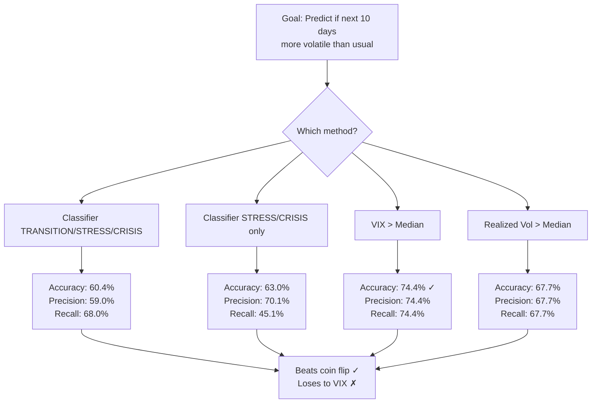

---

## 2. Predicting "Turbulent" (Top 25% Volatility)

### Accuracy Comparison

```mermaid
bar
    title Accuracy: Predicting Turbulent Days (Top 25% Volatility)
    x-axis [Method, Accuracy]
    y-axis "Accuracy %" 50 --> 80
    bar "Classifier (TRANSITION/STRESS/CRISIS)" 56.5
    bar "Classifier (STRESS/CRISIS only)" 71.8
    bar "Baseline: VIX > Median" 68.3
    bar "Baseline: Realized Vol > Median" 64.9
    bar "Always Guess No" 75
```

### Precision & Recall (More Important Here)

```mermaid
xychart-beta
    title "Precision vs Recall: Turbulent Target"
    x-axis [TRANSITION/STRESS/CRISIS, STRESS/CRISIS, VIX Median, Realized Vol Median]
    y-axis "Score %" 0 --> 100
    bar [34.0, 44.9, 43.3, 39.9]
    bar [78.3, 57.8, 86.6, 79.7]
    legend ["Precision", "Recall"]
```

### Trade-off Visualization

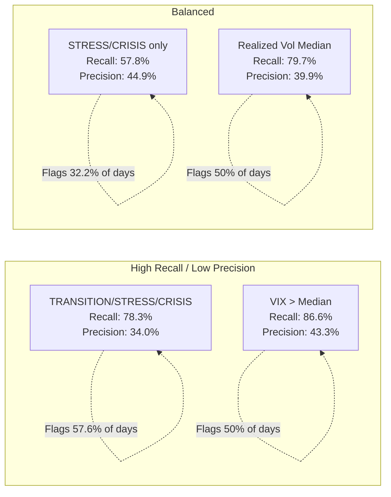

---

## 3. Signal Ranking Power (AUC)

### AUC Comparison

```mermaid
bar
    title AUC: Ranking Power for Volatility Targets
    x-axis [Signal, High-Vol AUC, Turbulent AUC, Rank Corr]
    y-axis "AUC / Correlation" 0 --> 1.0
    bar "Classifier Risk Score" 0.749
    bar "VIX Alone" 0.828
    bar "Realized Vol (20d)" 0.753
    bar "Entropy Ratio (ρ)" 0.620
```

### Detailed AUC Breakdown

```mermaid
xychart-beta
    title "AUC Breakdown by Signal"
    x-axis [High-Vol Target, Turbulent Target, Rank Correlation]
    y-axis "Score" 0 --> 1.0
    line "Classifier Risk Score" [0.749, 0.783, 0.50]
    line "VIX Alone" [0.828, 0.850, 0.67]
    line "Realized Vol (20d)" [0.753, 0.789, 0.52]
    line "Entropy Ratio (ρ)" [0.620, 0.639, null]
```

### Signal Quality Flowchart

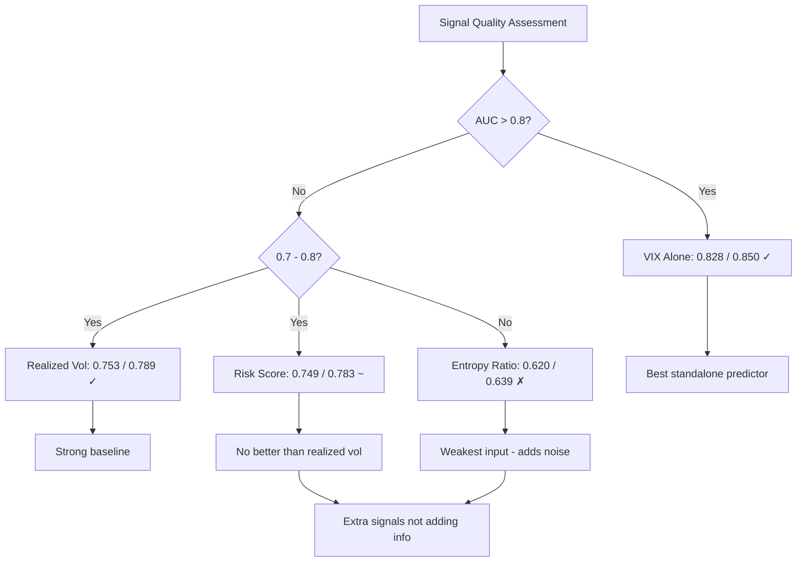

---

## 4. Catching Big Drops (> -5% in 10 Days)

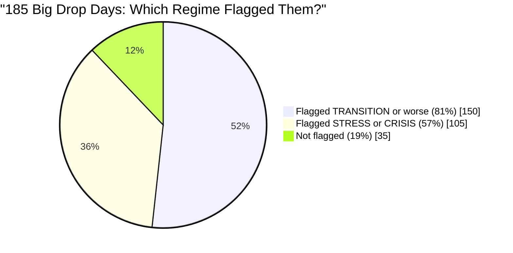

### Detection Funnel

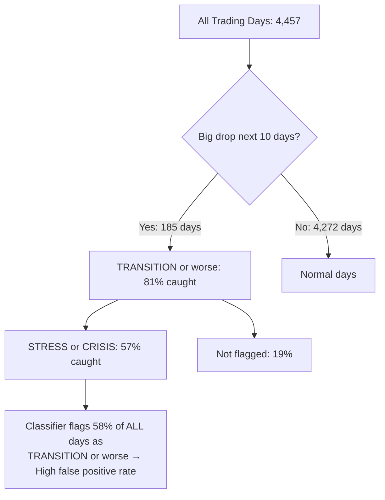

---

## 5. Predicting Direction

### Directional Accuracy

```mermaid
bar
    title Directional Prediction Accuracy
    x-axis [Signal, Accuracy]
    y-axis "Accuracy %" 0 --> 70
    bar "Market always UP (baseline)" 64.8
    bar "CALM_BULL predicts UP" 63.3
    bar "PCA Structure Score" 52.8
    bar "CALM_BEAR predicts DOWN" 45.1
    bar "Coin Flip" 50
```

### Signal Performance Matrix

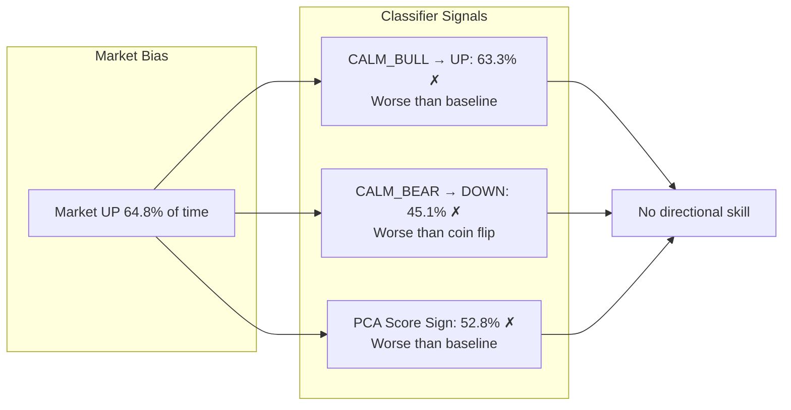

---

## 6. What Followed Each Regime (Next 10 Sessions)

### Realized Volatility After Each Regime

```mermaid
bar
    title Average Realized Volatility (Next 10 Sessions)
    x-axis [Regime, Realized Vol]
    y-axis "Annualized Vol %" 0 --> 40
    bar "CALM_BULL" 11.4
    bar "CALM_RANGE" 12.0
    bar "CALM_BEAR" 12.6
    bar "TRANSITION" 13.1
    bar "STRESS" 16.5
    bar "CRISIS" 33.8
```

### Average Return After Each Regime

```mermaid
bar
    title Average Return (Next 10 Sessions)
    x-axis [Regime, Avg Return %]
    y-axis "Return %" -1 --> 2
    bar "CALM_BULL" 0.48
    bar "CALM_RANGE" 0.21
    bar "CALM_BEAR" 0.25
    bar "TRANSITION" 0.49
    bar "STRESS" 0.72
    bar "CRISIS" 1.63
```

### Worst Return & Downside Risk

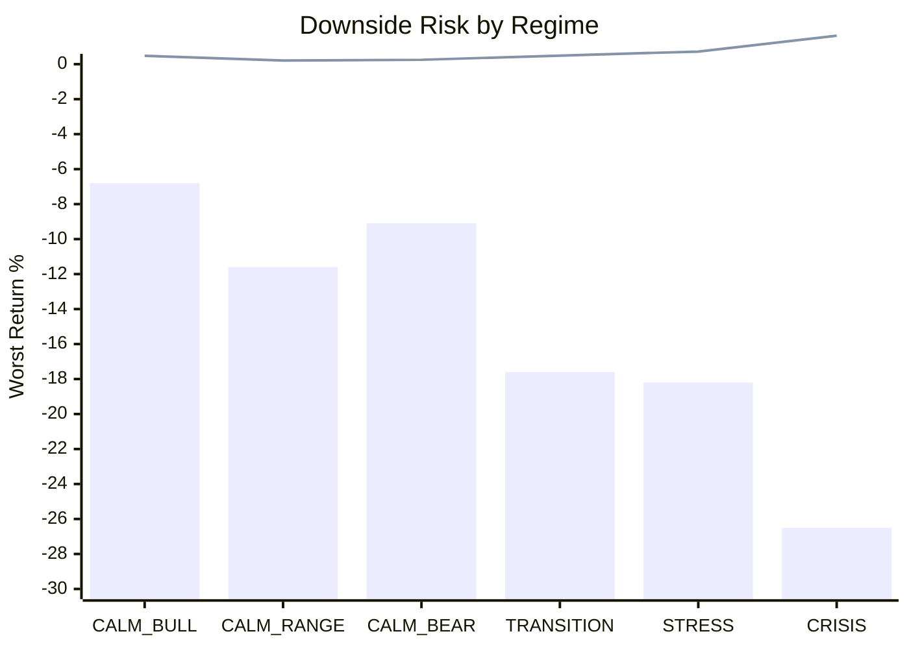

### % of Periods Down

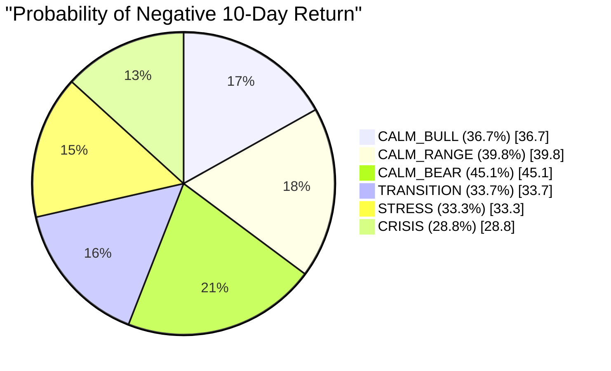

---

## 7. Regime Distribution

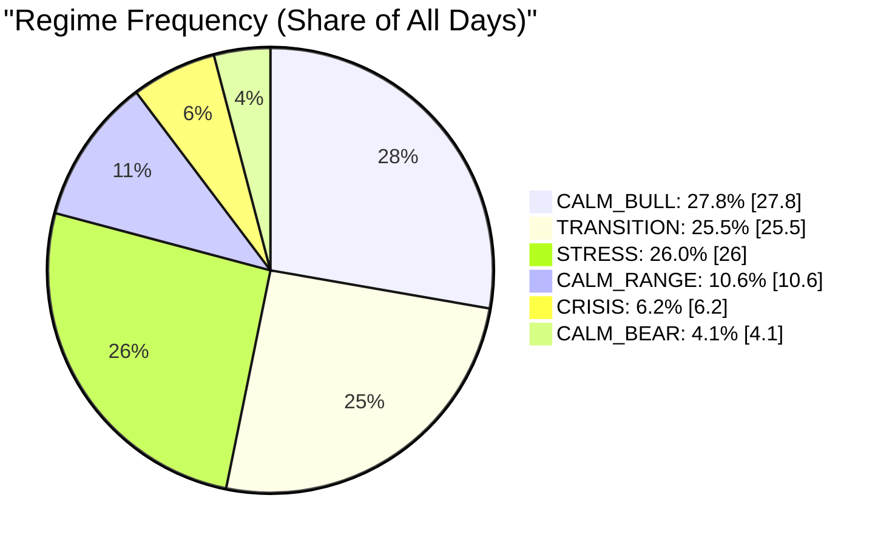

---

## 8. Overall Assessment Flowchart

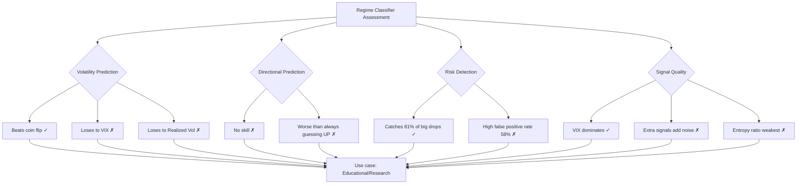

---

## 9. Key Takeaways Summary

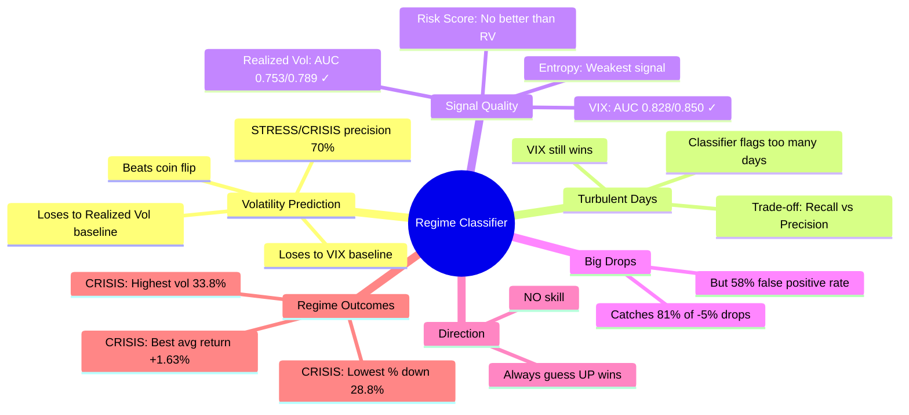

---

## How to View

These diagrams render automatically on GitHub. For local viewing:
- VS Code with Mermaid extension
- Obsidian
- Any Markdown viewer with Mermaid support

---

*Data source: [ACCURACY.md](ACCURACY.md) • Period: Feb 2009 – Oct 2026 (4,457 days) • Educational tool, not investment advice*