# Regime Classifier - Visual Analysis

This document uses Mermaid diagrams (rendered natively on GitHub) to visualize the accuracy data from [ACCURACY.md](ACCURACY.md).

> **Note:** GitHub's Mermaid supports: flowcharts, pie charts, mindmaps, timelines, Gantt, sequence, class, state, ER, user journey, git graphs, quadrant charts, and requirement diagrams. It does **not** support `bar`, `xychart-beta`, or `pie showData`.

---

## 1. Predicting "More Volatile Than Usual" (Next 10 Days)

### Accuracy Comparison

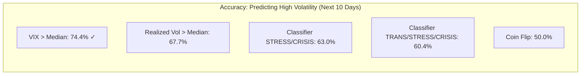

### Precision, Recall & Days Flagged

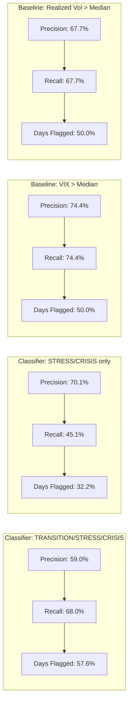

### Key Insight Flowchart

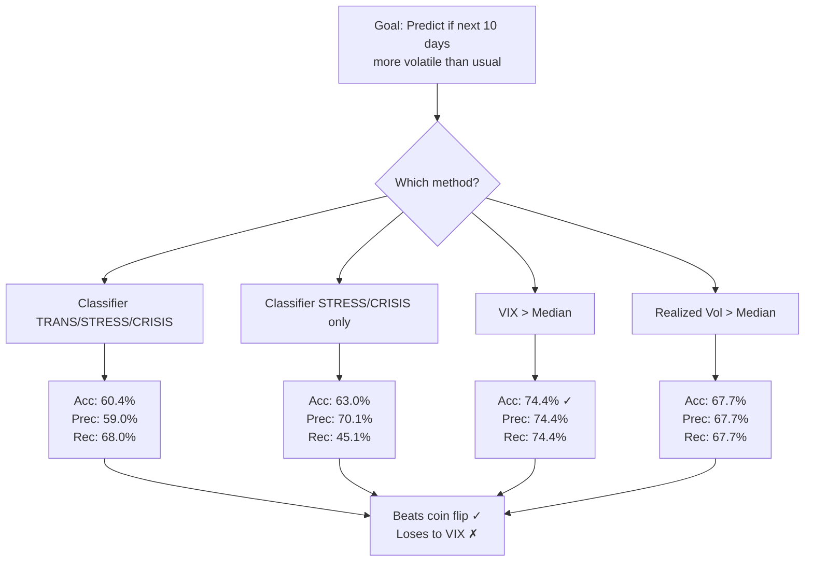

---

## 2. Predicting "Turbulent" (Top 25% Volatility)

### Accuracy Comparison

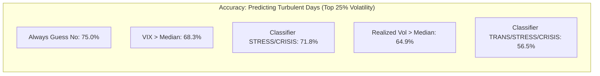

### Precision & Recall Comparison

```mermaid
flowchart LR
    subgraph "Precision / Recall Trade-off"
        direction TB
        P1[VIX Median: Prec 43.3% | Rec 86.6%]
        P2[Realized Vol: Prec 39.9% | Rec 79.7%]
        P3[STRESS/CRISIS: Prec 44.9% | Rec 57.8%]
        P4[TRANS/STRESS/CRISIS: Prec 34.0% | Rec 78.3%]
    end
```

### Trade-off Visualization

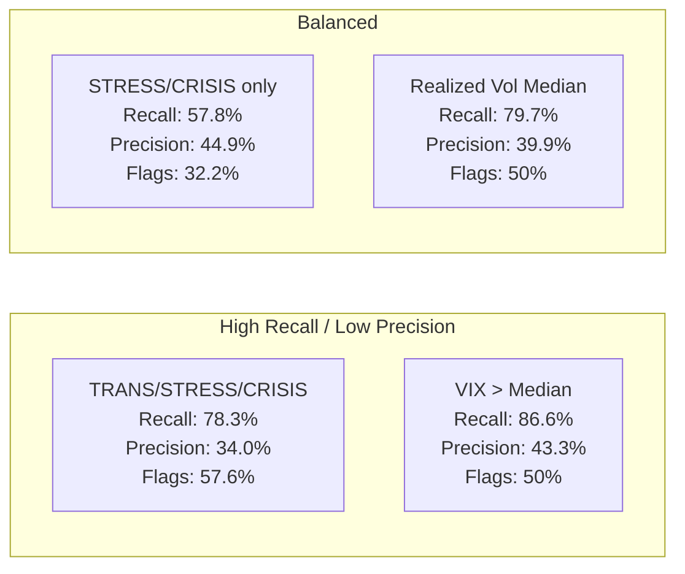

---

## 3. Signal Ranking Power (AUC)

### AUC Comparison

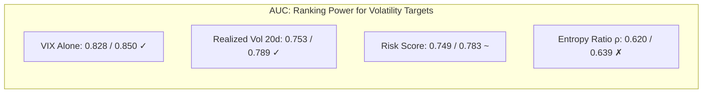

### Detailed AUC Breakdown

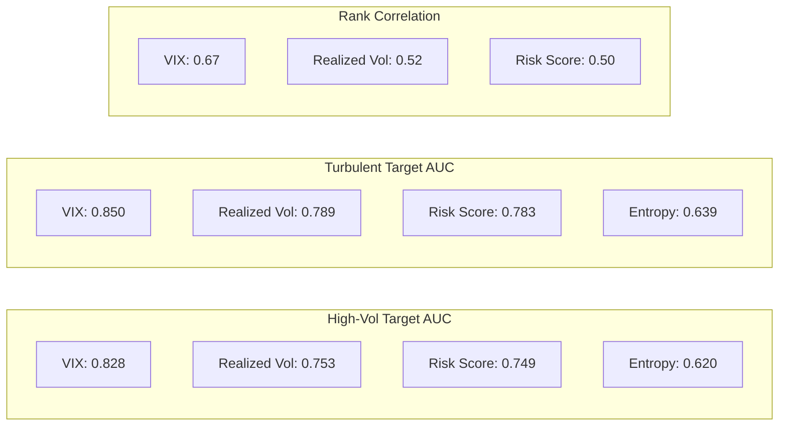

### Signal Quality Flowchart

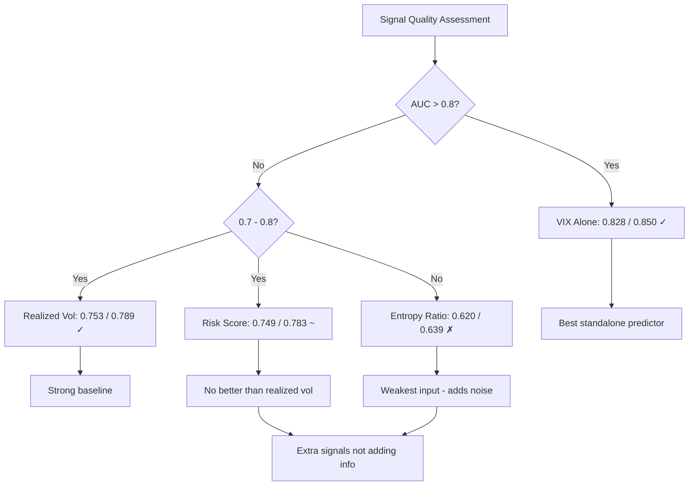

---

## 4. Catching Big Drops (> -5% in 10 Days)

### Detection Breakdown

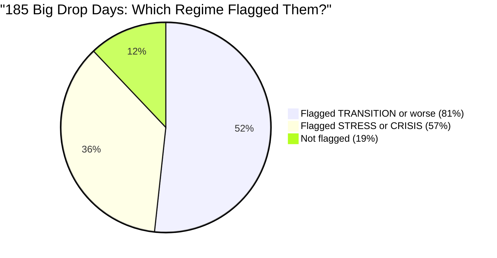

### Detection Funnel

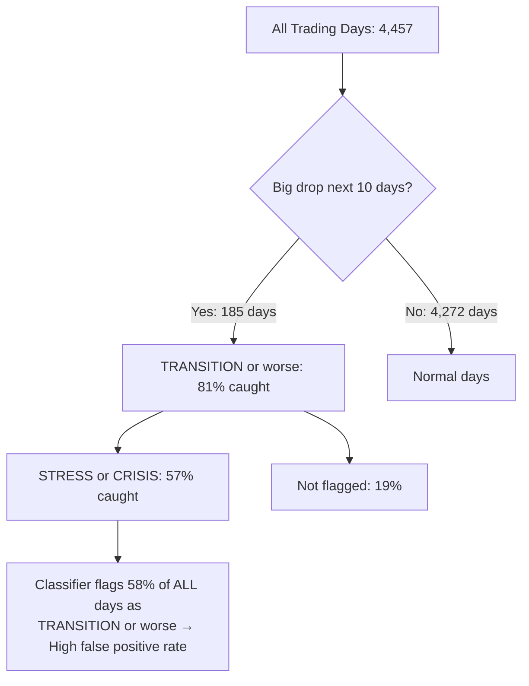

---

## 5. Predicting Direction

### Directional Accuracy

```mermaid
flowchart LR
    subgraph "Directional Prediction Accuracy"
        direction TB
        D1[Market always UP (baseline): 64.8%]
        D2[CALM_BULL predicts UP: 63.3%]
        D3[PCA Structure Score: 52.8%]
        D4[Coin Flip: 50.0%]
        D5[CALM_BEAR predicts DOWN: 45.1%]
    end
```

### Signal Performance Matrix

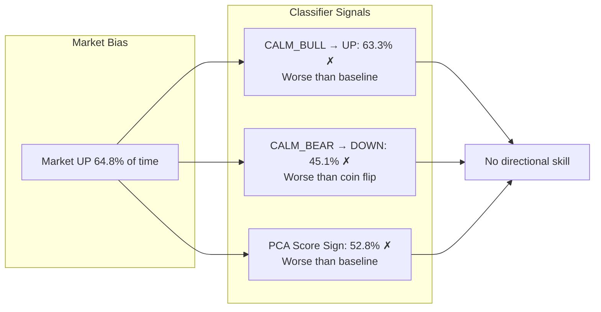

---

## 6. What Followed Each Regime (Next 10 Sessions)

### Realized Volatility After Each Regime

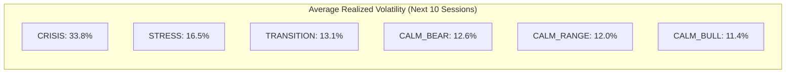

### Average Return After Each Regime

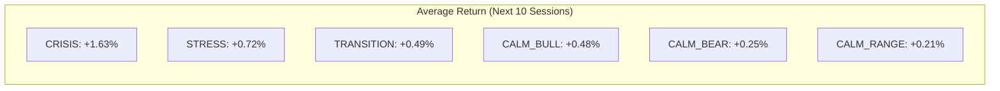

### Worst Return & Downside Risk

```mermaid
flowchart LR
    subgraph "Downside Risk by Regime"
        direction TB
        W1[CRISIS: -26.5% | Avg: +1.63%]
        W2[STRESS: -18.2% | Avg: +0.72%]
        W3[TRANSITION: -17.6% | Avg: +0.49%]
        W4[CALM_RANGE: -11.6% | Avg: +0.21%]
        W5[CALM_BEAR: -9.1% | Avg: +0.25%]
        W6[CALM_BULL: -6.8% | Avg: +0.48%]
    end
```

### % of Periods Down

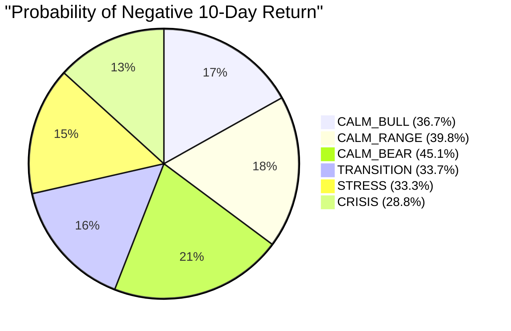

---

## 7. Regime Distribution

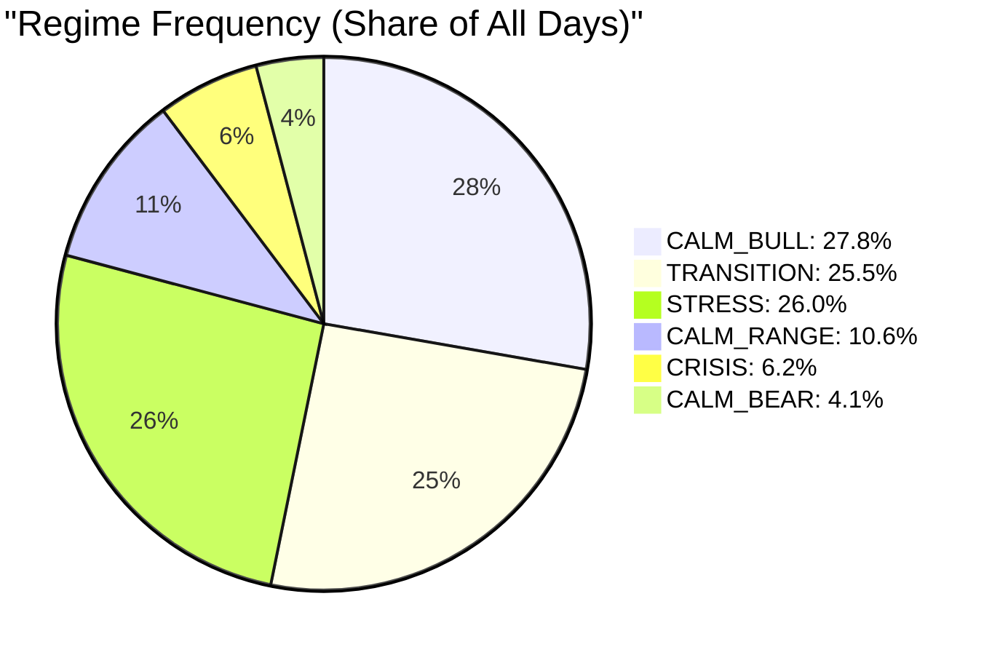

---

## 8. Overall Assessment Flowchart

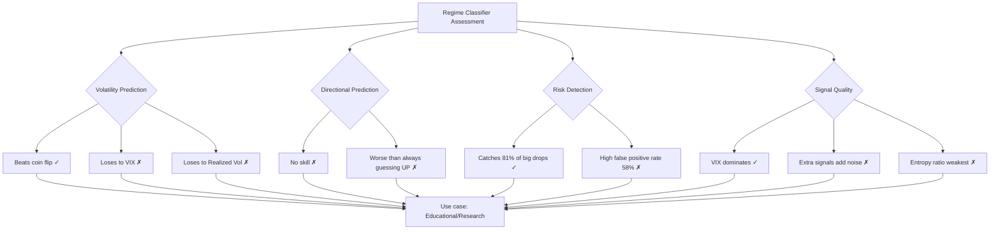

---

## 9. Key Takeaways Summary

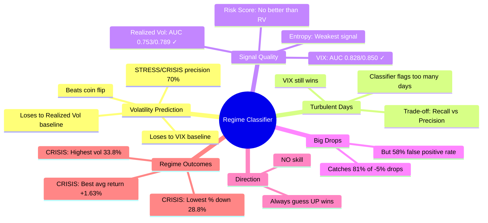

---

## How to View

These diagrams render automatically on GitHub. For local viewing:
- VS Code with Mermaid extension
- Obsidian
- Any Markdown viewer with Mermaid support

---

*Data source: [ACCURACY.md](ACCURACY.md) • Period: Feb 2009 – Oct 2026 (4,457 days) • Educational tool, not investment advice*